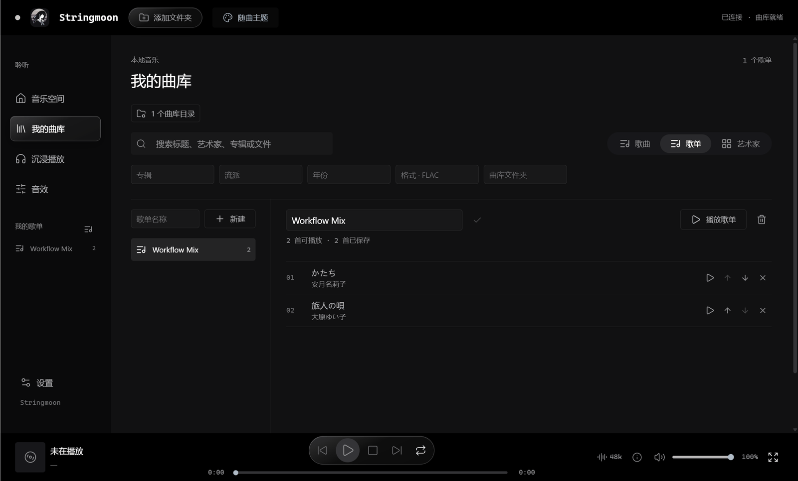
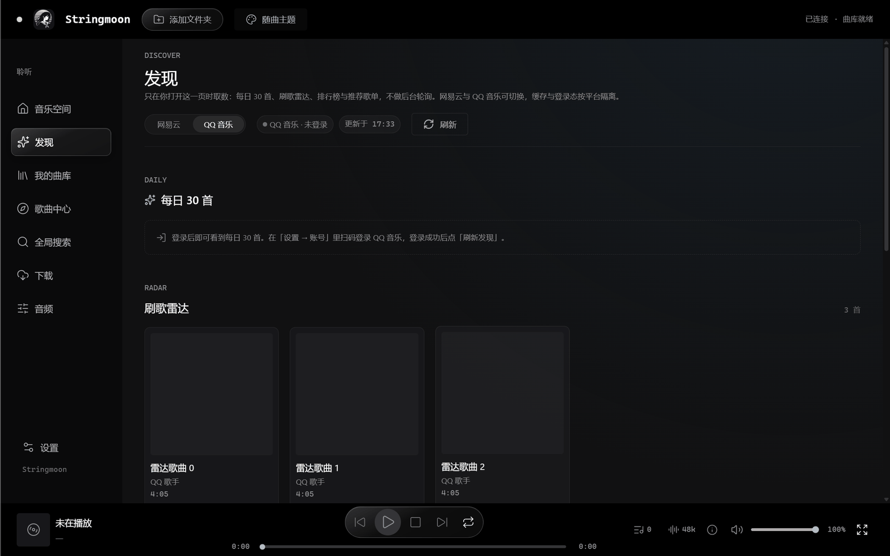
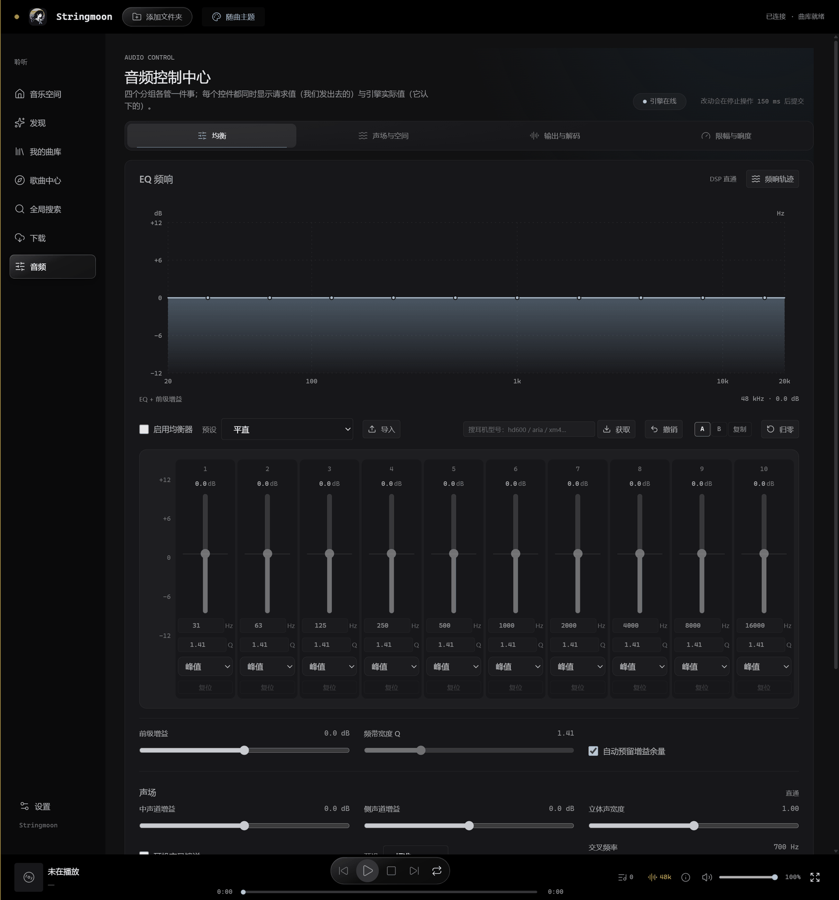
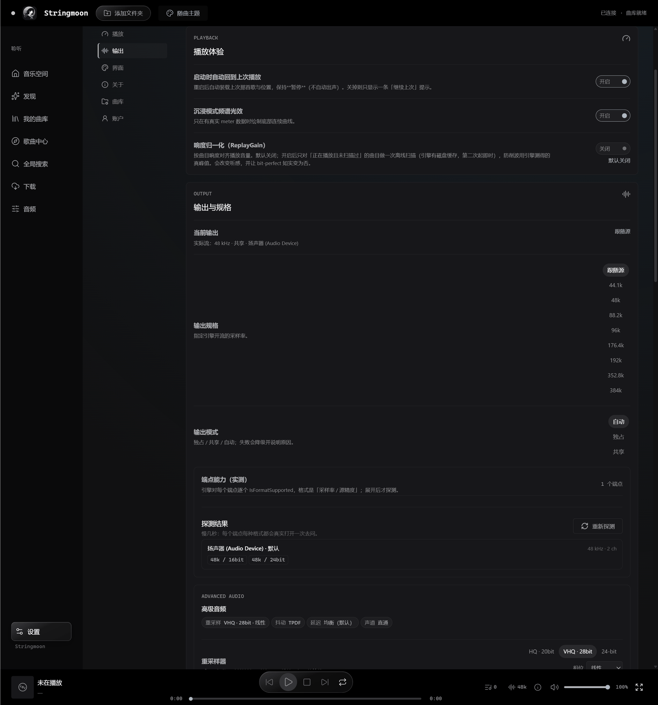
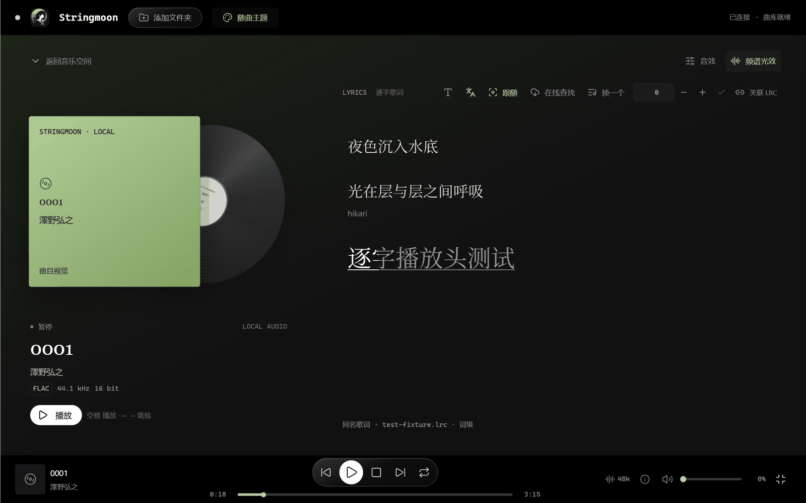

# Stringmoon

[中文说明](README.zh-CN.md) · **English**

**A high-performance HiFi music player for Windows** — your own local library plus your own NetEase Cloud Music / QQ Music account, driven by **Moonwave**, a C++20 audio engine.

WASAPI exclusive passthrough · up to 384 kHz / 32 bit · bit-perfect · 10-band parametric EQ · SoXR resampling · convolution room correction · EBU R128 loudness · hot-plug recovery

> **Formerly Twilight Echo.** The rename only touched branding (window title, typography, icons); the directory names `app/` / `engine/` and the protocol identifiers are unchanged.
>
> **License: MIT** (see [`LICENSE`](LICENSE)).
>
> **This is a personal / learning project.** It contains and distributes no music content; online playback depends entirely on **your own account** and unofficial third-party endpoints. Read [Known limitations](#known-limitations-and-honest-boundaries) and [Disclaimer](#disclaimer) before you start.

---

## Contents

[Screenshots](#screenshots) · [What this is](#what-this-is) · [Features](#features) ·
[Architecture](#architecture) · [Install](#install-prebuilt) · [Build from source](#build-from-source) ·
[Tests](#tests) · [Limitations](#known-limitations-and-honest-boundaries) · [FAQ](#faq) ·
[Repository layout](#repository-layout) · [License and credits](#license-and-credits) · [Disclaimer](#disclaimer)

---

## Screenshots

| | |
|---|---|
| <br><sub><b>Library</b> — multiple library folders, playlist / artist columns</sub> | <br><sub><b>Discover</b> — degrades honestly when signed out</sub> |
| <br><sub><b>Audio console · EQ</b> — frequency, gain and Q are per band</sub> | <br><sub><b>Settings · output and format</b> — mode, sample rate, device probing</sub> |
| <br><sub><b>Immersive playback</b> — vinyl stage and word-level lyrics</sub> | Captured from a **v0.4.0** development build with a synthetic test library; no personal paths or account data |

> Each screen is described in [`docs/screenshots/README.md`](docs/screenshots/README.md); details change between versions.

---

## What this is

Stringmoon is a **desktop player for the music you already own**. Two main goals:

1. **Use your own music-service account.** NetEase Cloud Music and QQ Music via QR sign-in; streams are fetched with your own membership/rights and handed to the engine through a local loopback proxy.
2. **Treat audio quality the way a player should.** Not something a browser `<audio>` tag can do: WASAPI exclusive passthrough, bit-perfect output, parametric EQ, loudness normalization, convolution correction, device hot-plug.

It is **not** a replacement for foobar2000 / HQPlayer and not a general-purpose player: no social features, store, downloader, DRM circumvention, VST3 hosting or music maps.

The hard boundary is written down in [`CONTRACT.md`](CONTRACT.md): **the engine is the only authority on sound** (decoding, DSP, WASAPI output, device management). The app owns the UI, library and platform integration, and the only thing between them is JSON Lines.

---

## Features

### Local library

| Capability | Detail |
|---|---|
| Multiple library folders | The library is a **set** of folders, persisted in user data and reproduced exactly on restart. A missing folder (unplugged drive / deleted directory) is reported as unavailable without hiding the others |
| Scanning and tags | The engine reads tags and audio properties with TagLib; containers are identified by **content** (magic bytes / `ftyp` / the codec id inside `OggS` pages), never by extension |
| Audio formats | **Built into the engine**: FLAC, WAV, MP3, Ogg Vorbis, Ogg-FLAC (dr_libs / stb_vorbis). **System decoding**: AAC / ALAC (`.m4a` through Windows Media Foundation). **DSD**: DSF / DFF extracted to 176.4 kHz / 24-bit PCM. Whether `.opus` / `.wma` / `.ac3` / `.aif` play depends on the Media Foundation components registered on your machine — the UI shows an honest capability matrix (native / system decoding / unsupported) instead of pretending everything works |
| Artwork | Embedded image → sidecar image → `cover/folder/front` → glyph fallback; you can pin your own cover, and **removing it only drops the mapping, never touches your images or music files** |
| Tag editing | Edit title / artist / album / genre / year in place. Edits go to user data (`track-overrides.json`); **your music files are not rewritten** |
| Playlists and views | Playlists, folder view (hierarchy / breadcrumbs / enqueue whole tree), playback queue (drag, move up/down, remove, clear, 5 sort modes) |
| Lyrics | Local `.lrc` / `.ttml` / `.yrc`, embedded lyrics, online fetch; word-level timing, translation, romanization; can be saved back to disk |

### Online platforms

| Capability | Detail |
|---|---|
| Sources | **NetEase Cloud Music**, **QQ Music**, a generic **Meting** source (needs Docker or a compatible Meting API you host), and **GD Music Station** (a built-in public HTTP source, no sign-in) |
| Sign-in | Primarily QR. **NetEase also supports web sign-in** (the main process opens a window, reads cookies, and stores credentials encrypted with Electron `safeStorage` / DPAPI). **QQ is QR-only** — its backend rejects web-cookie sign-in, so that entry point was removed from the UI |
| Backend shape | The app starts a **local API server subprocess** on demand (dynamic port, health probing, backoff restart on crash); the renderer only ever talks to `127.0.0.1` |
| Discover | NetEase: daily recommendations / personal radio / charts / recommended playlists. QQ: 30 daily tracks / song radar / charts / recommended playlists. Switchable per platform, and it **degrades honestly when signed out** (no fetch, no fake data) |
| Global search | One search across local and online sources (GD Music Station has its own group; third-party sources are not downloadable) |
| Download | Online tracks can be downloaded and tagged (MP3 via ID3v2); third-party sources (GD Music Station) are **not** downloadable |
| Session keep-alive | First check about 8 s after launch, then every 6 hours. NetEase attempts renewal; for QQ the app only verifies and says plainly that renewal is unsupported |

> **GD Music Station** is a built-in third-party public HTTP source (no sign-in, resolves direct URLs). It currently has a **known playback problem**; see [Known limitations](#known-limitations-and-honest-boundaries).

### The audio engine: Moonwave

> The built binary is still named `twilight-engine.exe` (historical naming; renaming it would break the packaging chain). **Moonwave is its name and its version line.**

| Capability | Detail |
|---|---|
| Separate process | `twilight-engine.exe` (Moonwave), C++20 + CMake, talking to Electron only through stdin/stdout JSON Lines; audio samples **never** cross that channel |
| Output modes | WASAPI **exclusive** (passthrough at the track's native rate / bit depth) and **shared**. When exclusive is unavailable it degrades automatically and says so in the UI instead of pretending |
| Sample rates | Follow source / 44.1 / 48 / 88.2 / 96 / 176.4 / 192 / 352.8 / 384 kHz. On the development machine the default endpoint really opens at **384 kHz / 32 bit** in exclusive mode (device limits differ; the UI shows what the endpoint actually reported) |
| Resampling | SoXR 0.1.3 streaming resampler, in the chain only when the device rate differs from the source — and labelled "resampled" when it is |
| Equalizer | **10-band parametric**: 31.25 / 62.5 / 125 / 250 / 500 / 1 k / 2 k / 4 k / 8 k / 16 k Hz grid, RBJ peaking by default, Q 0.5–4, ±12 dB. Every band's frequency / Q / type (peaking / low shelf / high shelf) is editable independently; AutoEQ, Equalizer APO and CSV curve import; built-in Harman target fitting |
| ReplayGain | EBU R128 loudness scan (track + album), track / album modes, preamp, prevent-clip, with an on-disk result cache |
| Convolution | Room / headphone impulse responses, 1024-frame uniformly partitioned overlap-add, any block size, zero allocation during playback, fixed 1024-frame latency |
| Spatial | Bauer-style crossfeed, M/S stereo widening, 24-azimuth analytic HRIR binaural virtualisation, plus balance / mono / channel swap / per-channel gain / delay tools |
| Click-free transport | Fade-out floor of **15 ms** on pause / seek / track change, then **15 ms of silence** written after the fade reaches zero, waiting for the device to actually drain before stopping the stream |
| Hot-plug | Listens for device changes; after a USB DAC is plugged/unplugged or the default endpoint changes it falls back to the default device and reopens the stream |
| Limiter and metering | Controllable limiter (ceiling / release / lookahead), true peak (TP), spectrum and level meters |

### Interface and listening

| Capability | Detail |
|---|---|
| Music space / immersive playback | Vinyl stage, immersive cover-and-lyrics layout, spectrum light band |
| Design system | Nothing's three-channel state encoding (light / form / type) plus liquid-glass materials; the "system" is enforced by lint (`check:tokens`), not by good intentions |
| Resume on launch | Returns to the last playback position, **paused and silent**, and can be turned off in settings |
| Tray and single instance | System tray controls, single-instance lock (a second launch focuses the existing window) |

---
## Architecture

Three OS processes (the app's two plus the engine) and two process boundaries (IPC and JSON Lines):

```text
Electron 44 app process (app/)
├─ renderer     React 19 + TypeScript
│               UI · lyrics · spectrum · state encoding
│               talks to the main process only through the preload contextBridge
└─ main         Node + TypeScript
                windows / tray / single instance / settings
                EngineHost          ── spawns the engine, matches replies by monotonic id, fails explicitly on timeout
                StreamingManager    ── starts local API server subprocesses on demand (dynamic port + health probe)
                LoopbackMediaProxy  ── wraps third-party direct URLs as 127.0.0.1/<token> for the engine

         │  stdin / stdout, one JSON per line (JSON Lines)      │  HTTP 127.0.0.1:<dynamic port>
         ▼                                                     ▼
  twilight-engine.exe (Moonwave)                  local API server subprocess (optional)
  C++20 · separate process · sole sound authority  NetEase / QQ / Meting
  decode → resample → DSP → WASAPI exclusive/shared
         │
         ▼
      audio device
```

### Engine ⇄ app: JSON Lines over stdio

The protocol is frozen in [`CONTRACT.md`](CONTRACT.md) §3. Three hard rules:

1. **stdout may only contain JSON Lines** (one event per line); every log line must go to stderr — otherwise the front end's parser dies.
2. **Audio samples never cross this channel.** The engine writes to the device directly; the channel carries commands and state only.
3. Times are integer milliseconds, sample rates are Hz, volume is 0.0–1.0.

```jsonc
// stdin: command stream. Each command carries an app-assigned id; the reply must carry the same id.
{"id":4,"cmd":"open","trackId":"tl_0001"}
{"id":5,"cmd":"play"}
{"id":12,"cmd":"set_output","mode":"exclusive","deviceId":"..."}

// stdout: event stream
{"ev":"ready","protocol":1,"version":"0.1.0","devices":[...]}
{"ev":"state","state":"playing","trackId":"tl_0001","outputMode":"exclusive",
 "sampleRate":384000,"bitDepth":32,"bitPerfect":true}
{"ev":"position","trackId":"tl_0001","positionMs":42000,"durationMs":213000}
```

**Degrading is not an error.** If exclusive mode cannot open, the engine switches to shared and expresses it through `state.outputMode` + `state.bitPerfect=false` rather than returning a failure; `ERR_DEVICE` is only for "neither mode could open the device". There are exactly six error codes (`ERR_DEVICE` / `ERR_DECODE` / `ERR_NOTFOUND` / `ERR_STATE` / `ERR_UNSUPPORTED` / `ERR_INTERNAL`), all frozen.

---

## Install (prebuilt)

If you would rather not compile: download `Stringmoon-Setup-<version>.exe` from the **Releases** page of this repository.

1. Run the installer. If Windows shows "Windows protected your PC", click **More info → Run anyway** —
   the installer is **not code-signed**; that is expected, not a corrupt file.
2. Pick an install directory and continue; launch `Stringmoon` from the Start menu.
3. Local playback: add a music folder under **Settings → Local library** and wait for the scan.
4. Online playback: start the NetEase / QQ backend under **Settings → Streaming accounts**, then sign in by QR.
   The installer bundles its own runtime (Node.js + both backends), so **the target machine needs no Node.js, npm or VC++ runtime**.
   Note: **a build from source does not include that bundled runtime** — see the next section.

User data lives in `%APPDATA%\twilight-echo-app` (library index, playlists, settings, sessions); uninstalling keeps it by default, and reinstalling will not lose it.

---

## Build from source

**Prerequisites**: Windows 10/11 x64, Node.js ≥ 22.12, pnpm 11, CMake ≥ 3.25, MSVC (VS 2022 generator or Build Tools). Full steps, flags and pitfalls are in [`docs/BUILD-FROM-SOURCE.md`](docs/BUILD-FROM-SOURCE.md).

```powershell
# 1) Engine (C++20) — third-party sources ship with the repo, so this builds offline
powershell -ExecutionPolicy Bypass -File engine/tools/build.ps1
#    output: engine/bin/twilight-engine.exe

# 2) App (Electron + React)
cd app
pnpm install
pnpm dev            # dev mode; probes engine/bin/twilight-engine.exe, falls back to the mock engine (silent)
pnpm build          # emits app/out/ (main / preload / renderer)
pnpm dist           # NSIS installer → app/release/
```

- **The engine binary is not committed**: `engine/bin/` is build output (already in `.gitignore`). A fresh clone must build the engine first, otherwise `pnpm dev` runs the mock engine (silent) and `pnpm dist` produces a package without an engine.
- **Third-party sources are committed**: `engine/third_party/` contains TagLib 2.3.2, SoXR 0.1.3, dr_libs, stb_vorbis, kissfft, libebur128 and utfcpp (724 files, 7,522,241 bytes ≈ 7.2 MiB), so the engine builds **without network access**. `engine/tools/fetch-deps.ps1` is only needed if you want to re-fetch or upgrade those dependencies.
- **Swapping the engine during development**: set `TWILIGHT_ENGINE=<path to exe>`. Without it, the app probes the packaged resources directory, then `engine/bin/twilight-engine.exe`, then falls back to the mock engine (for pure UI work).
- **The installer's bundled runtime (said honestly)**: the official installer embeds Node.js 24 plus the two platform backends (`app/resources/runtime.zip`, about 151 MB unpacked). **That zip is a one-off artifact of the official packaging step; no script in this repo generates it.** When it is missing, electron-builder only logs a `file source doesn't exist` warning and skips that resource (**the build still succeeds**), so the installer simply has no bundled runtime — online playback then requires your own Node.js and the two backend commands configured under **Settings → Streaming accounts**. Details in [`docs/BUILD-FROM-SOURCE.md`](docs/BUILD-FROM-SOURCE.md).

---

## Tests

All commands run from `app/` (`pnpm <script>`). The results below are measured on the current state of this repository.

| Command | What it does | Current result |
|---|---|---|
| `pnpm typecheck` | Type-check both tsconfigs (main + renderer) | exit 0 |
| `pnpm check:tokens` | Design-token ratchet (no literal colour values) | 0 violations |
| `pnpm check:css` | CSS brace / structure check | braces balanced |
| `pnpm test:app` | Unit tests (protocol, library, lyrics, EQ, playback memory, updater, …) | **474 / 474 pass** |
| `pnpm test:protocol` | Mock-engine protocol self-test (CONTRACT §3 assertions) | 42 checks passed |
| `pnpm test:c2` | C2 state-encoding assertions | 11 / 11 pass |
| `pnpm test:electron` | Real Electron + real engine end-to-end (screenshots and layout assertions) | needs an exclusive audio device and a prior `pnpm build` |
| `pnpm test:player` / `test:listening` / `test:startup` / `test:library` | Playwright interaction and pixel acceptance | needs a build and a local library |
| `pnpm test:l2` | Loopback proxy + real engine integration (local HTTP source, offline) | needs `engine/bin/twilight-engine.exe` and **a real FLAC as an argument** (see below) |

The engine ships its own diagnostics and self-tests:

```powershell
engine\bin\twilight-engine.exe --selftest        # offline golden tests (EQ response / dither / loudness / channels), no device touched
node engine\tools\drive.mjs --list                # list the 23 end-to-end steps
node engine\tools\drive.mjs --step=dsp            # EQ / ReplayGain / bit-perfect honesty
engine\bin\twilight-engine.exe --probe-format <file>   # can this file actually play, and if not, why
```

> ⚠️ Some tests **really produce sound** (`test:integration`, the playback steps of `drive.mjs`), and the e2e suites fight over the exclusive audio device. **Do not run several suites at once**, and do not run e2e while music is playing.
>
> `pnpm test:l2` needs a real FLAC passed down to the underlying script:
> `node tools/test-l2-integration.mjs <path-to-some.flac>`. Without an argument it throws a `usage` error by design — that is not a bug.

---
## Known limitations and honest boundaries

These are **known and currently accepted** limits, written down so you do not have to discover them the hard way:

1. **The installer is not code-signed.** Windows SmartScreen reports an unknown publisher; choose **More info → Run anyway**. This is normal for the current build, not a corrupt download.
2. **Every online endpoint is unofficial.** The NetEase / QQ endpoints are provided by community servers and **may be rate-limited, changed or shut down at any time**; Discover and search can therefore occasionally return nothing. Use your own account only, and accept the platform terms and copyright responsibility yourself.
3. **QQ Music caps the number of signed-in devices** (upstream code `20279`). When you see "login device limit reached", remove an old device in the QQ Music mobile app and scan again — the client cannot work around it, and restarting or switching networks will not help.
4. **GD Music Station currently has a playback problem**; prefer not to use it for now. Its upstream is also a third-party public API that can change at any time.
5. **Shared mode can never be 384 kHz.** In WASAPI shared mode the stream format is dictated by the device mix format (usually 48 kHz / 32-bit float), so picking a high sample rate has no effect. The UI shows **requested** and **actual** side by side; that is not a bug.
6. **Exclusive mode can be taken away by another program.** If another app holds the default endpoint exclusively, the engine reports it honestly and degrades to shared mode; playback still works but is no longer bit-perfect.
7. **Windows x64 only** (Windows 10 1803+; the bundled runtime needs the system `tar.exe`). Windows N editions need the Media Feature Pack for playback.
8. **DSD is not output natively**: DSF/DFF are extracted to 176.4 kHz PCM; there is no DoP.
9. **Word-level lyric quality depends on the upstream.** Tracks missing from AMLL TTML DB / NetEase / LRCLIB only get line-level lyrics, or none at all.
10. **A build from source has no bundled runtime by default** (see [Build from source](#build-from-source)); online playback then needs your own Node.js and backends.
11. **End-to-end tests seize the exclusive audio device.** `pnpm test:electron` and several Playwright suites need the real engine and the default output endpoint; if another program holds the device exclusively, the tests get `0x8889000A` (device in use) and fail — that is an environment problem, not broken code. **Never run suites concurrently**, and not while music is playing.

---

## FAQ

**Q: It says the runtime is missing / online features will not start.**
On first online use the official installer spends about 5 s unpacking the bundled runtime into `%APPDATA%\twilight-echo-app\runtime`. If it reports missing, reinstall once so it unpacks again. A build from source has no bundled runtime: install Node.js 24 yourself and fill in the backend commands under **Settings → Streaming accounts**.

**Q: No sound, or no sound right after plugging in headphones.**
Check the output device and mode under **Settings → Output and format** first. After a hot-plug the engine falls back to the default endpoint automatically; if it still does not recover, pick the device once more.

**Q: Exclusive mode will not open / it says the device is in use.**
The default output endpoint is being held exclusively by another program. WASAPI error `0x8889000A` is `AUDCLNT_E_DEVICE_IN_USE`. Close the other player, or switch to shared mode in settings — shared mode still plays, it just is not bit-perfect.

**Q: There is still a faint click on pause or track change.**
This version implements a 15 ms fade-out plus 15 ms of silence waiting for the device to drain. If you still hear something, it usually comes from a USB DAC or Bluetooth switching power/clock at Start/Stop — that is driver level and software cannot remove all of it.

**Q: QQ sign-in keeps saying the QR code expired.**
It may not be the QR code. Read the message: if it says "login device limit reached", remove an old device in QQ Music → Settings → Device management on your phone and scan again. The three QR channels (mobile QQ / WeChat / QQ Music app) are not interchangeable — pick the channel that matches the app you scan with.

**Q: Can I point it at my own API backend?**
Yes — every row under **Settings → Streaming accounts** takes a custom command, with quote support (install paths often contain spaces) and a `$PORT` placeholder; the app allocates the port dynamically and passes it to the backend via the environment.

**Q: Where is my data, and does uninstalling delete it?**
`%APPDATA%\twilight-echo-app` (library index, playlists, settings, sessions; plus a `runtime` directory of about 151 MB after the first online use). The uninstaller **keeps** the data directory by default; delete it manually if you want a clean slate.

---
## Repository layout

```
.
├─ app/                       Electron app (v0.4.1)
│  ├─ src/main/               main process: engine host, streaming manager, loopback proxy, library and settings
│  ├─ src/preload/            contextBridge bridge
│  ├─ src/renderer/           React 19 UI (components / views / audio console)
│  ├─ src/shared/             protocol, models and pure functions shared by both processes
│  ├─ tools/                  unit tests, Playwright acceptance, mock engine, packaging and update scripts
│  └─ electron-builder.yml    NSIS packaging and extraResources (engine exe, bundled runtime)
├─ engine/                    the Moonwave engine, C++20 (v0.1.0)
│  ├─ src/                    entry / protocol / decode / DSP / WASAPI / devices and diagnostics
│  ├─ third_party/            committed third-party sources (TagLib, SoXR, dr_libs, …)
│  ├─ tools/                  fetch-deps.ps1, build.ps1, the drive.mjs suite, assorted probes
│  ├─ fixtures/               real event traces and a library snapshot (for app-side tests)
│  └─ CMakeLists.txt          build definition (static CRT, /W4, C++20)
├─ docs/                      design, specs, implementation records, screenshots and build docs
│  ├─ BUILD-FROM-SOURCE.md    complete build guide (toolchain, flags, pitfalls)
│  └─ screenshots/            the UI screenshots referenced above
├─ CONTRACT.md                frozen contract for the engine ⇄ app protocol and boundary (read-only)
└─ README.md                  this file
```

---

## License and credits

### Code in this repository

**MIT License** — the full text is in [`LICENSE`](LICENSE) at the repository root (Copyright © 2026 Stringmoon).

### Third-party components

The complete list, with the license text and file each entry was read from, is in [`THIRD-PARTY-NOTICES.md`](THIRD-PARTY-NOTICES.md); the provenance record is in [`docs/PROVENANCE.md`](docs/PROVENANCE.md).

One point that needs spelling out: **the engine statically links TagLib (LGPL-2.1 / MPL-1.1) and SoXR (LGPL-2.1)**.
The **complete sources of both ship with this repository** (`engine/third_party/taglib-2.3.2/`, `engine/third_party/soxr-0.1.3/`), and the build scripts (`engine/tools/build.ps1`, `engine/tools/fetch-deps.ps1`) are public and reproducible —
anyone can rebuild the engine following [`docs/BUILD-FROM-SOURCE.md`](docs/BUILD-FROM-SOURCE.md), or swap in their own build of either library.

Main third-party components (all open source):

| Component | Used for | License |
|---|---|---|
| [TagLib](https://github.com/taglib/taglib) 2.3.2 | reading audio tags and properties | LGPL-2.1 / MPL-1.1 |
| [SoXR](https://github.com/chirlu/soxr) 0.1.3 | streaming resampling | LGPL-2.1 |
| [dr_libs](https://github.com/mackron/dr_libs) | FLAC / WAV / MP3 decoding | public domain / MIT-0 |
| [stb_vorbis](https://github.com/nothings/stb) | Ogg Vorbis decoding | public domain (dual-licensed MIT) |
| [libebur128](https://github.com/jiixyj/libebur128) 1.2.6 | EBU R128 loudness measurement | MIT |
| [kissfft](https://github.com/mborgerding/kissfft) | real FFT for spectrum and convolution | BSD-3-Clause |
| [utfcpp](https://github.com/nemtrif/utfcpp) 4.2.1 | UTF-8 conversion (a TagLib dependency) | BSL-1.0 |
| [Electron](https://github.com/electron/electron) 44 | application shell | MIT |
| [React](https://github.com/facebook/react) 19 | renderer | MIT |

### Credits

This project stands on a lot of shoulders. **The three tiers below separate "quoted", "learned from" and "read for orientation"** — that is not boilerplate: each tier carries different legal and moral obligations, and blurring them is unfair to everyone involved.

#### 1. Quoted (data, documents and algorithm literature — no code)

| Source | Used for | Note |
|---|---|---|
| [RBJ Audio EQ Cookbook](https://www.w3.org/TR/audio-eq-cookbook/) (Robert Bristow-Johnson) | biquad coefficients for the 10-band EQ | a **published formula**, i.e. a mathematical fact; the engine derives coefficients from it rather than copying code |
| [EBU R128](https://tech.ebu.ch/docs/r/r128.pdf) / ITU-R BS.1770 | loudness normalization and true-peak criteria | measurement methods defined by the standards |
| The **export formats** of [AutoEQ](https://github.com/jaakkopasanen/AutoEQ) and [Equalizer APO](https://sourceforge.net/projects/equalizerapo/) | so you can import headphone correction curves you already have | only the ability to read their file formats; **no code or data from them** |
| [AMLL TTML DB](https://github.com/amll-dev/amll-ttml-db) TTML structure | word-level lyrics via `ttm:role` / per-word timing | format alignment only |

#### 2. Learned from (design ideas and parameters, rewritten as our own implementation)

| Project | License | What was learned | Boundary |
|---|---|---|---|
| [Px-asen/Twilight_Echo](https://github.com/Px-asen/Twilight_Echo) | Apache-2.0 | the overall Electron + C++20 native-engine layering; the `outputPerfect` two-state model (expressing "degradation is not an error"); the idea of capability self-reporting via `capabilities` | line-by-line comparison: **4.63%** of effective code lines coincide, the longest contiguous match being struct field declarations like `std::string title;` — **no implementation-level copying** |
| [BroNekoX/QueMusic](https://github.com/BroNekoX/QueMusic) | Apache-2.0 | the **order** of the `AudioDsp` chain and the auto-headroom idea; two pitfalls documented there (bypass also skips hard clipping; limiter off does not mean unclipped) are deliberately avoided here | credited by name in the source header of `engine/src/dsp.cpp`; formulas rewritten, no code moved |
| [Moekotori/ECHO](https://github.com/Moekotori/ECHO) | AGPL-3.0 | session state machine, player lifecycle layering, telemetry field trade-offs | **design reading only, no code copied** (longest contiguous line match: 5, all of them COM coerced signatures) |
| [chthollyphile/folia-major](https://github.com/chthollyphile/folia-major) | AGPL-3.0 | UI organization and platform integration approach; its issues and pitfall notes saved a lot of trial and error | **design reading only, no code copied** (12 high-suspicion files compared; longest contiguous match 4 lines) |
| Issue reports from [yt-dlp](https://github.com/yt-dlp/yt-dlp) / [Navidrome](https://github.com/navidrome/navidrome) | Unlicense / GPL-3.0 | failure modes when resolving online streams, and Subsonic protocol pitfalls | issues and docs read only; their code is not used |

#### 3. Read for orientation (shaped judgement, never entered the implementation)

| Source | What it informed |
|---|---|
| [Electron](https://github.com/electron/electron) / [React](https://github.com/facebook/react) official docs | process model, `contextBridge`, renderer performance limits |
| Windows WASAPI / IAudioClient3 docs | availability criteria for exclusive vs shared, `AUDCLNT_E_*` error semantics |
| [Nothing](https://nothing.tech/) brand and GDK design language | the **idea** of three-channel state encoding (light / form / type); none of its restricted assets were used |
| Public discussion around [Folia](https://github.com/chthollyphile/folia-major) / [ECHO](https://github.com/Moekotori/ECHO) | product judgement about what a player should look like |

#### 4. Boundaries that must be stated

- **The AGPL-3.0 projects (Folia / ECHO) are used here as design reading only**: their source code is not included, their artifacts are not linked, and no expressive code was copied.
  The per-file comparison evidence (including longest contiguous matches) is in [`docs/PROVENANCE.md`](docs/PROVENANCE.md) §3.
- If you intend to **merge and redistribute** this project together with those AGPL projects, verify the respective terms yourself — this repository makes no judgement about the consequences of such a combination.
- **If a source that deserves credit is missing here, please open an issue.** Adding a credit is far cheaper than arguing an exception.

---

## Disclaimer

- This project is **personal, self-use and learning software**, provided "as is", without warranty of any kind, express or implied.
- It **does not provide, distribute or host any music content**, and it offers no ability to bypass paywalls, DRM or regional restrictions. Every stream played online comes from the rights your own account holds on the respective platform.
- The NetEase, QQ Music and GD Music Station endpoints are **unofficial** channels; they may violate the respective terms of service and may stop working at any time. All consequences and responsibilities of using them rest with the user.
- Use **only your own account**, and do not use this software for bulk scraping, vote manipulation or anything else that degrades a platform's normal service. The project name, UI and icons were created for this project; the third-party components and the public projects referenced above remain the property of their respective authors (see [License and credits](#license-and-credits)).
